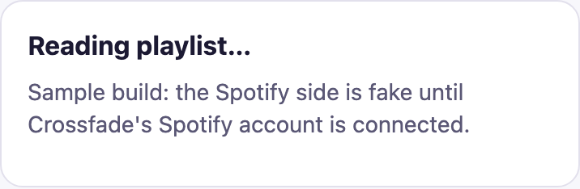
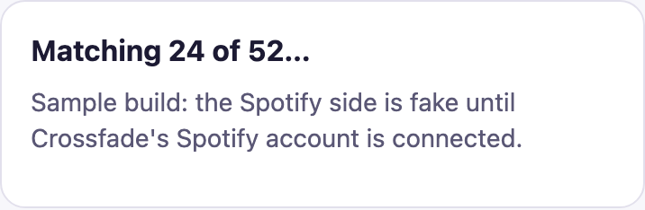
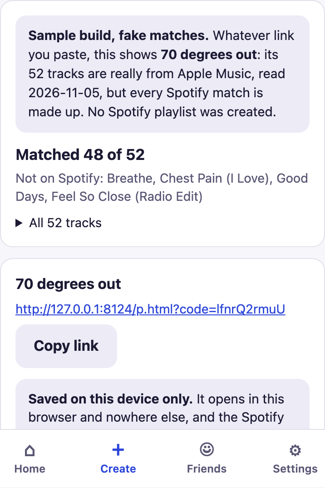

# Crossfade

A playlist bridge between Apple Music and Spotify. Send one link; the playlist rebuilds
itself as a real, playable playlist in whatever service your friend already uses.

The thing it replaces is a screenshot of a tracklist that the other person has to retype
song by song. Most of the time, they don't — so the playlist never actually gets shared.

**Status (2026-11-05):** 🚧 Building the bridge. The app runs locally, and `create-link`
(Apple link in, Spotify playlist and report out) runs end to end against a **fake**
Spotify. It isn't deployed yet: the Crossfade Spotify account and the database migration
come next. Solo capstone for IST300, Syracuse University, Fall 2026. See *Phases* below.

**Live URL:** not deployed yet.

## Run it

**You need:** Python 3 (macOS ships with one, so 3.9 or newer is fine) and Node 24 for the
tests. You don't need npm to run the app.

```bash
git clone https://github.com/aavalo11/my-capstone-aaliyah.git
cd my-capstone-aaliyah
cp .env.example .env        # optional for now, see Secrets below
python3 -m http.server 8000 --bind 127.0.0.1 --directory src
```

Open http://localhost:8000. Stop it with `Ctrl+C`.

**Pass signal:** Home → *Recently added* lists rows from Supabase. If it says *Couldn't
load your playlists*, the free Supabase project is probably paused (see *Things that went
wrong* below).

**Secrets:** the app itself needs no `.env`. Its Supabase URL and **publishable** key are
public by design and already in `src/config.js`. The `.env` is only for the terminal
scripts in `scripts/`. `SPOTIFY_CLIENT_ID` and `SPOTIFY_CLIENT_SECRET` come from the
Crossfade Spotify developer app (developer.spotify.com → Dashboard → the app → Settings).
`SPOTIFY_REFRESH_TOKEN` and `SENDER_PASSCODE` aren't used by anything yet.
`SUPABASE_URL` and `SUPABASE_PUBLISHABLE_KEY` can be copied from `src/config.js`. There's
no login, so there's nothing to sign in to (backlog S14).

**Tests:**

```bash
node --test tests/unit/*.test.js                               # no install
cd tests && npm install && npx playwright install chromium && cd ..   # first time only
node tests/e2e/run.js
```

---

## Phases

Each phase links to what it produced. Dates are from the commit history.

| # | Phase | When | What came out of it | State |
|---|---|---|---|---|
| 1 | **Concept** | Sep 9–17 | `docs/01-concept-brief.md`, repointed once to cross-service sharing | Done |
| 2 | **Research** | Sep 10 → | W01 (`docs/research/interview-01.md`). It **declined** the cross-service premise. W02 and W03 haven't run | **Open: the biggest risk** |
| 3 | **Backlog** | Sep 17 | `docs/backlog.md`: stories, MoSCoW, MVP slice; ADRs 0002–0005 | Done, provisional on W02/W03 |
| 4 | **Requirements** | Sep 27 | `docs/02-prd.md` (CP-M2); ADR 0006, nobody logs in | Done, revised as the build goes |
| 5 | **Prototypes** | Oct 1–16 | Three clickable prototypes in `docs/design/` | Done |
| 6 | **Architecture and stack** | Oct 8–16 | `docs/03-architecture.md` (CP-M3); Supabase + plain HTML (ADR 0007), Netlify (ADR 0008) | Done |
| 7 | **Front end** | Oct 8–26 | `src/`: Home, Create, link CRUD (ADR 0010), the friend's match report (ADR 0009); `tests/` | Done, on sample data |
| 8 | **Outside services** | Oct 29–Nov 3 | Read Apple's public share page, no key (ADR 0012); first outside call (ADR 0013); pay for Spotify Premium (ADR 0014) | Done |
| 9 | **The bridge: `create-link`** | Nov 5 → | Apple reader, R2 matching, steps 1–9 with retries and cleanup, 83 unit tests, a dry run against a real playlist, and Create playing it back (ADR 0015) | **In progress**, fake Spotify |
| 10 | **Deploy and go live** | next | Crossfade's Spotify credentials, database migration, Edge Function, Create calls it for real, then the demo test | Not started |
| 11 | **Benchmark and demo** | after 10 | Match-rate benchmark (PRD §8) on 5 playlists, then the six-shot screen recording | Not started |

### Phase 9 on screen

Create plays back one recorded `create-link` run (ADR 0015). The 52 tracks are really from
Apple Music; **every Spotify match is fake**, and the screen labels it as a sample. The
screenshots below are from 2026-11-05, before the `Sample` labels were shortened.

| Reading | Matching | Report, then the link |
|---|---|---|
|  |  |  |

## Who it's for

| | |
|---|---|
| **Sender** | On Apple Music, on her phone, mid-conversation. Needs it to take five seconds. |
| **Recipient** | On Spotify, often a free or family-plan account. Wants to hear the playlist without it being written into their library uninvited. |

## The job it does

> When a friend and I are on different music services and I want to share a playlist
> with them, I want to send one link that rebuilds the playlist in whatever app they
> already use, so we can trade music without either of us switching services or adding
> songs one at a time.

## MVP slice

Apple Music → Spotify, one direction, one playlist: preview it, see an honest match
report, press play. Deliberately smaller than the MUST column.

The demo test: a friend opens a texted link, sees `Matched 23 of 25` with the two
failures named, taps play, and **audio comes out of the phone** — then closes the app and
finds nothing was added to their library. No step where you have to say "and then imagine
it saves."

## What it will never do

- **Move audio files between services.** Downloads are DRM-encrypted and licensed to the
  account, not the listener. The bridge moves track identities; each person plays on
  their own subscription.
- **Guarantee perfect matching.** Remixes, live versions, explicit vs. clean, and
  regional availability all break it. An honest `matched 47 of 50` beats a silent
  substitution.
- **Synchronize playback across services.** No public API exposes playback position on
  another service.

## Repo layout

```
docs/01-concept-brief.md   CP-M1 · what it is and why          (done)
docs/02-prd.md             CP-M2 · requirements                (due Sep 27)
docs/03-architecture.md    CP-M3 · how it's built              (due Oct 11)
docs/backlog.md            Lab 3 · 11 stories, MoSCoW, MVP     (done)
docs/research/             interview notes, verbatim + reading
docs/design/               UI notes, prototypes, wireframes/ for sketch photos
docs/decisions/            one file per call that could have gone otherwise
docs/features/             one card per built feature: checks, evidence, what I corrected
supabase/schema.sql        database setup, run once in the dashboard
supabase/functions/        create-link: Apple reader, R2 matching, the build (not deployed yet)
scripts/                   terminal tools: one Spotify search, the create-link dry run
src/                       the app: plain HTML/CSS/JS (started 2026-10-08)
tests/                     unit tests + Playwright browser checks (started 2026-10-26)
.env.example               the secrets the Week 9 bridge needs, names only
```

## Running this project

**Stack:** Supabase (hosted database, and later Edge Functions and Auth) plus plain
HTML, CSS and JavaScript. No framework, no build step, no `npm install`. Why:
`docs/decisions/0007-supabase-and-plain-html.md`.

### What has to exist on the machine

| Thing | Why | Check |
|---|---|---|
| Python 3 | Only to serve `src/` at a local address. It comes with macOS. | `python3 --version` |
| A browser | To open the app | — |
| A Supabase project | The database. It's hosted, so nothing gets installed for it. | supabase.com dashboard → `crossfade` |

Nothing is installed system-wide. The Supabase CLI and Docker aren't needed yet; they
arrive in Week 9 with Edge Functions.

### Start it

From the repo folder:

```sh
python3 -m http.server 8000 --bind 127.0.0.1 --directory src
```

Open **http://localhost:8000**. Stop the server with `Ctrl+C`.

**Pass signal:** Home → *Recently added* lists the rows from the Supabase `links` table.

### Connect Supabase (once per project)

1. Copy the SQL inside the file (`pbcopy < supabase/schema.sql`), paste it into
   Supabase → **SQL Editor**, and run it. Paste the SQL itself, not the file name.
   It creates the `links` table, read-only to the public key, and it's safe to run twice.
2. **Project Settings → API Keys**: copy the Project URL and the **publishable** key
   into `src/config.js`. The Project URL is **not** the address in your browser bar:
   - Wrong: `https://supabase.com/dashboard/project/irzqwrznqvtjrrmkddzw`
   - Right: `https://irzqwrznqvtjrrmkddzw.supabase.co`
3. **Never** put the secret or `service_role` key in `src/`. Everything in there is
   public.

### Things that went wrong the first time

| What I saw | What fixed it |
|---|---|
| `syntax error at or near "supabase"` in the SQL Editor | I pasted the file name. Paste the SQL *inside* `supabase/schema.sql`. |
| `Could not find the table 'public.links'` | The SQL never ran. Run it again, or run `notify pgrst, 'reload schema';`. |
| Home says *Couldn't load your playlists* after a break | Free Supabase projects pause after about a week of no use. Dashboard → **Restore project**, wait a few minutes. |
| `Address already in use` when starting the server | An old server is still running. Close that terminal, or use port `8001`. |

### What changed from the first draft

I didn't like the layout of the first version, so I reworked it and added ideas I
wanted: more buttons on Home (paste from clipboard, invite a friend, new and top songs),
and a Friends screen that shows how friends interact: their playlists, their songs, and
how similar our taste is.

### Seeing every state

Every screen has an empty and an error state. Add `?demo=empty` or `?demo=error` before
the `#`, for example `http://localhost:8000/?demo=error#/home`. Create plays back a
recorded build before it saves a link (ADR 0015).

To run `create-link` yourself against a real Apple playlist with a fake Spotify:
`node scripts/create-link-dry-run.ts "<Apple Music playlist link>"` (Node 24).

### Running the tests

```sh
node --test tests/unit/*.test.js   # no install; Node 24 (it runs the .ts files directly)
node tests/e2e/run.js              # browser checks; first run needs Playwright, see tests/README.md
```

**Pass signal:** `# fail 0` for the unit tests, then `All browser checks passed`.

### What's real and what isn't (updated 2026-11-05)

| Screen | State |
|---|---|
| Home → Recently added, Your numbers | Real: reads Supabase |
| Home → New this week, Top songs, Top albums | Real: Apple's free public US chart (no key). *Find on Spotify* opens Spotify's own search |
| Create → Paste a link | Link, passcode and name are checked here. A recorded build plays first, with real Apple tracks and **fake** Spotify matches (ADR 0015). The link and its songs are saved **in this browser only** (ADR 0010) |
| `create-link` (server) | Built and unit-tested with a **fake** Spotify and database. Not deployed; never run against real Spotify |
| Home → Your links | Real, but local: rename and delete the links made on Create. Tap a name to see its songs; each matched song opens in Spotify's search |
| Friend page `p.html?code=…` | Shows a link made in this browser with its songs, or *removed* after a delete. `code=sample` is a sample playlist (ADR 0009). **Play in Spotify** appears once a link has a real Spotify playlist |
| Create → Search songs | Hidden. Would search Spotify through the server; holding pen, no evidence yet (backlog S16) |
| Friends | Sample data only (backlog S13). Shared playlists open to their songs, each opening in Spotify's search |
| Settings → Account | Hidden until the Lab 5 login (backlog S14). The theme setting works |
| Home → Listening history, Fix a match, How matching works | Hidden. Not built (S12, S9), and matching isn't explained on screen (ADR 0016) |

## A note on the research

The first interview (`docs/research/interview-01.md`) **did not support this product.**
W01 said cross-service sharing would be "nice," then said plainly he *"doesn't mind not
being able to work with other music services."* His actual pain was downloading and cost.

That finding is recorded rather than buried, and the backlog marks the bridge stories as
provisional until two more interviews land. If they come back the same way, the honest
move is to repoint the capstone — see `docs/decisions/0003-best-evidenced-stories-in-could.md`.
